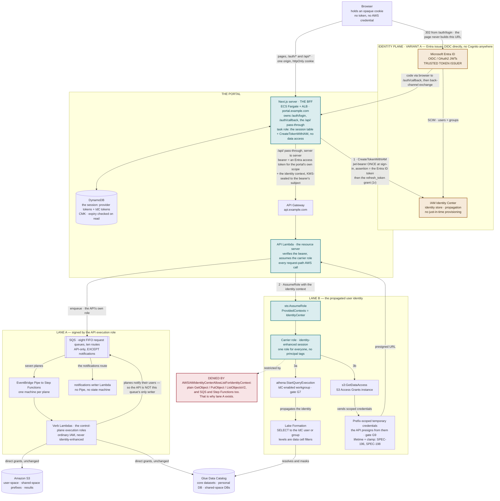
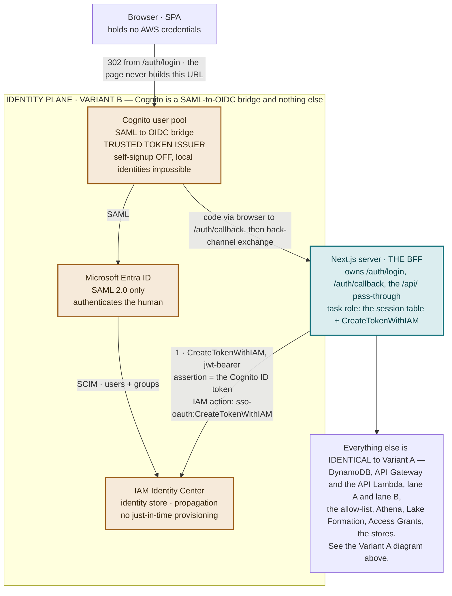

# Target Architecture — the two identity variants, drawn

**Status:** Companion to `docs/transition_plan.md`, which stays the single source of truth. This
file adds **pictures and one rejected fork**; where it and the plan disagree, the plan wins.
**Last updated:** 2026-11-15, when the BFF box became the Next.js server and the API Lambda
(`transition_plan.md` §4.7). Validated against live AWS and Microsoft documentation on 2026-08-19 —
see *What was checked against the live docs* at the end.

**What these are.** The successor-account architecture at the end of **Phase 5**, drawn once for each
of the two identity variants: one *user* credential plane — the identity-enhanced session — with Athena and
Lake Formation governing the catalog and S3 Access Grants governing storage, and the browser holding
no AWS credential at any point — the last of those being the property **gate G9** tests.

Everything below the JWT is identical in both variants. What changes is the door the JWT comes
through, which is why the transition is one plan and not two — and why **Variant B is drawn as its
identity plane alone**: repeating sixty near-identical lines to change four would make you hunt
the difference instead of being shown it.

**What they are not.** Today's architecture, or the **Phase 1 interim plane** (the API assuming
the shared portal role with a `username` session tag, `${aws:PrincipalTag/username}` still scoping
every policy). That plane is provider-agnostic and identical under both variants, so drawing it would
repeat this page's lower half under both identity planes and add nothing.

Read `transition_plan.md` §3.3 for the variant split itself, §3.4 and §3.9 for why there is one
credential plane and what governs storage, §3.5 for the token flow, and §4.6/§4.7 for hosting.

## If you are new: the words these drawings assume

The diagrams use project shorthand. Enough to read them:

| Term | What it means here |
|---|---|
| **Phase 5** | The last build phase of the client-environment transition (`transition_plan.md` §7): Identity Center identities in Lake Formation, the carrier role, S3 Access Grants. The drawings are the picture at the *end* of it. |
| **Phase 1 interim plane** | The way station before that: the API assumes the shared portal role with a `username` session tag, and `${aws:PrincipalTag/username}` still scopes every policy. It retires in Phase 5. |
| **The two variants** | Which product issues the JWT — Entra directly **[A]** or a Cognito bridge **[B]**. Decided by gate G8, in Phase 0. Not yet decided. |
| **Gate G7** | *Unproven.* Can a plain `StartQueryExecution`, from our own code on an identity-enhanced session, run on an IdC-enabled workgroup? The plan calls it a blocker. |
| **Gate G9** | *Unproven.* Can the API presign an S3 URL from Access-Grants-vended credentials, and can a browser redeem it? The "no credentials in the tab" property rests on this. |
| **Levels** | A user's entitlement to a core dataset — `normal` (masked columns/rows) or `sensitive` (all of them). Implemented as Lake Formation data cell filters, one per level per dataset. |
| **The eight request queues** | shared-spaces, notifications, table-builder, table-share, data-quality, file-send, archive, and file-ops. Ten routes because archive and table-build each have two. **`infra/` today has seven and six state machines** — the eighth queue and seventh machine arrive with the file-ops plane (SPEC-187 → 191, specced, unbuilt), and these drawings are the end state. The observability/logs queue is a separate ninth. |
| **Verb Lambdas** | The single-task functions each control plane's state machine invokes. Ordinary IAM roles. |

Two things the drawings deliberately do **not** answer, because nothing has settled them: **which Entra
claim carries the catalog-safe username** under [A] (you cannot write to Entra, so it must be found or
derived — `transition_plan.md` §6.1), and **what a user sees when Identity Center has no matching
record** for them, since there is no just-in-time provisioning and their exchange simply fails.

## How to read them

Below the API the drawing splits into **two lanes**, because two different credentials leave it:

- **Lane A** is the API's own execution role, writing the eight FIFO **request** queues that drive
  the asynchronous control planes. It is *not* their only writer: **notifications is one of those
  eight**, and the control-plane roles write it whenever a plane notifies a user. SPEC-200 FR-008
  makes that an acceptance criterion precisely because "the API is the only writer" is the easy
  thing to say and is false about that one queue.
- **Lane B** is the user's identity-enhanced session. It is the only credential **S3 Access Grants**
  ever sees. It is **not** the only principal **Lake Formation** knows, and that difference is bigger
  than it looks: the shared portal role and several control-plane roles hold Lake Formation
  permissions today, there are multiple data-lake administrators, and `post_confirmation.py` and
  `shared-space-create` each issue **named grants to the portal role for every user and every shared
  space** at runtime — so the count grows with the tenant, not with the module list.

  > **This document does not carry that inventory, and must not be used as one.** It is a picture of
  > the credential planes, not a re-keying runbook. For Phase 5, the sources are
  > `transition_plan.md` Phase 5 and §3.8, **§3.12** — which says who issues the per-user grants
  > `post_confirmation.py` issues today, and which of them wait on SCIM — and
  > **`transition_plan.md` §3.11**, which owns the
  > ordering — *entitle every member and verify, then retire the tags, then revoke the standing
  > role-level grants*. Reversed, every member is locked out.

Keeping them apart is the point. The allow-list that denies plain S3 on lane B denies SQS and Step
Functions too, so the control planes could never have ridden the user's credential even if someone
wanted them to. They cross this revision untouched for the separate reason §3.4 gives: their
execution roles are ordinary IAM roles and are *not* identity-enhanced, so lane B's restrictions
never applied to them.

**Colour in the diagrams carries meaning, and only reinforces what the labels already say:**
**brass** is the identity plane — the one part that differs between [A] and [B]; **teal** is where
the identity-enhanced session is *established and carried*, the rest of lane B sitting inside the box
that names it; **red** is what the allow-list denies. Everything else is unstyled.

## Variant A — the baseline

Entra issues the OIDC JWT itself and is the Identity Center trusted token issuer. No User Pool, no
Identity Pool, no Managed Login, no custom attributes, and nothing to lock down against a
self-asserted email.



## Variant B — the fallback

Used only if the Entra tenant is hard SAML-only. Trusted identity propagation needs an OAuth 2.0
JWT and does not accept SAML, so something must convert a SAML-authenticated session into an OIDC
token. That is Cognito's entire job here.

**Only the identity plane is drawn, because only the identity plane changes.** Against Variant A,
exactly four things move:

| | Variant A | Variant B |
|---|---|---|
| Sign-in hop | Browser → Entra | Browser → **Cognito** → SAML → Entra |
| Trusted token issuer | Entra | **Cognito** |
| Assertion exchanged | The Entra ID token | The **Cognito** ID token |
| Self-asserted identity | Impossible by construction | A **configured** guardrail: self-signup off, local identities impossible |

Everything else in the drawing — the Next.js server, API Gateway and the API Lambda, DynamoDB, both
lanes, the allow-list, Athena, Lake Formation, Access Grants and the stores — is the Variant A
diagram unchanged.



## Three readings the drawings exist to prevent

- **The API does not call Step Functions.** It writes SQS — ten enqueue routes over eight FIFO
  **request** queues — and an EventBridge Pipe drives the machine, except notifications, which is a
  writer Lambda with no Pipe and no machine. **Those counts are the post-Arc-A end state, which is
  what these drawings show**: `infra/` today has seven request queues and six machines, and the
  eighth and seventh arrive with the file-ops plane (SPEC-187 → 191, specced and unbuilt). SPEC-200
  says so in terms — *"every 'eight'/'ten' figure in this spec is stated post-Arc-A"*. The SPA imports no `@aws-sdk/client-sfn` today, and the
  API is a Python Lambda whose enqueue surface SPEC-200 defines as `sqs:SendMessage` on exactly those
  eight request-queue ARNs — no `states:` grant anywhere. Two refinements the drawings encode: the
  **notifications queue is one of the eight**, and the control-plane roles write it too, so the API is
  not its only writer (SPEC-200 FR-008 makes this an acceptance criterion); and the observability/logs
  queue is a **ninth**, outside the eight, which the API role also writes.
- **Presigned URLs and S3 Access Grants are not alternatives.** Access Grants is how the *credential*
  is obtained; presigning is how the *bytes* move. That half is drawn on its own below: as a single
  edge spanning the whole diagram it stretched the main drawing and squeezed everything else.

  ```mermaid
  flowchart LR
    AG["S3 Access Grants<br/>s3:GetDataAccess"] -->|"prefix-scoped<br/>temporary credentials"| API["API Lambda"]
    API -->|"presigns locally · SigV4,<br/>no network call"| URL(["Presigned URL"])
    URL -.->|"returned to the tab through the server —<br/>the URL, never a credential"| BR["Browser"]
    BR -.->|"redeems it directly ·<br/>bytes never touch compute"| S3[("Amazon S3")]

    classDef session fill:#DBEDEF,stroke:#0E6E78,stroke-width:2px,color:#0B3F45
    class API session
  ```

  Presigning is a local SigV4 operation the API can
  perform with whatever credential the environment hands it, and the transfer never touches compute.
  Whether S3 then evaluates the grant's scope correctly at redemption is exactly what **gate G9**
  tests, and it is **unproven**; a presigned URL also cannot outlive the credential that signed it.
  If G9 fails, the fallback is scoped credentials handed to the browser.
- **The BFF is the Next.js server, and it owns both redirects.** Through all of Arc B the SPA owned
  them — Amplify `signInWithRedirect()` and `lib/returnPath.ts`. Since SPEC-257 the server has its
  own `/auth/login`, which holds `state`, the PKCE verifier and the nonce in a `__Host-` sign-in
  cookie and 302s to the provider, and its own `/auth/callback`, the registered redirect URI, which
  exchanges the code, stores the tokens, sets the opaque cookie and 302s to the return path; since
  SPEC-262 the browser signs in through them. **There is no BFF Lambda and no authorizer/worker split**: this page
  drew one, under "the target splits this", while the API was going to be the session's home, and
  the 2026-11-15 revision of `transition_plan.md` §4.7 retired it. The API stays a verifier the
  router calls.

## Rejected: letting the ALB authenticate before it serves the bundle

An Application Load Balancer can run the whole OIDC code flow itself (`authenticate-oidc` on an
HTTPS listener rule), so it is fair to ask whether it could own the redirect and hand an already
authenticated request to the container — and whether the BFF is then duplicating work.

**It cannot be relied on to produce the assertion, and the AWS docs will not even settle why.**
`x-amzn-oidc-data` is a JWT the **ALB** signs — `signer` is the load balancer ARN and the key is
served from `public-keys.auth.elb.{region}.amazonaws.com` — so it can never validate against the
trusted token issuer registered in Identity Center (Entra under [A], the bridge pool under [B]).
That leaves `x-amzn-oidc-accesstoken`, and an access token is **not** disqualifying in itself — AWS
states the assertion *"can be an identity token or an access token."* But that header is published
under the heading **"Legacy unsigned headers"**, documented as *"unsigned and cannot be independently
verified by your application"*, and carries an explicit note: *"The Application Load Balancer signs
only the `x-amzn-oidc-data` header… provided for backward compatibility."* Alongside *"The
Application Load Balancer creates a new access token when authenticating a user… however it does not
pass the ID token information"*, the balance of evidence is that nothing the ALB forwards is an
IdP-signed JWT that Identity Center would accept. Building sign-in on the hope that this header
happens to carry Entra's own token is not a supportable plan, and none of the three objections below
depend on settling it.

Three more reasons it does not compose here, each independent of the first:

- **~~It protects the wrong origin.~~ Weakened 2026-11-15, and no longer a reason on its own.** It
  read: ALB authentication applies per listener rule on that ALB, the API is API Gateway, a separate
  origin (§4.6), so it would still need its own verification. Since SPEC-257 the session lives on
  the ALB's own origin, and once SPEC-262 lands the browser reaches the API only through that
  server, so the origin becomes the right one. What survives is the duplication: the ALB would run a second OIDC
  client beside the server's, with a second session, a second logout path and another clock.
- **It is a second reader of the same identity, able to disagree.** SPEC-193 premise 5 declined an
  API Gateway authorizer for exactly this reason, one layer down. The Next.js server is one OIDC
  client and the API verifies the token that client obtained, so they read one identity; an ALB
  would run an independent OIDC client and could disagree with both. *(This bullet used to contrast
  the ALB with a planned authorizer split of the API; that split is retired.)*
- **Its operating limits bite this app specifically.** Claims plus access token over 11 KB return an
  HTTP 500 to the client and increment the `ELBAuthUserClaimsSizeExceeded` **metric**; a client must
  complete login within a fixed
  **15 minutes**; and AWS calls out single-page apps whose JavaScript polls — `OnUnauthenticatedRequest:
  deny` answers those AJAX calls with a 401, which this app's notification polling would meet.

**What it can still do, if the security review asks for it.** `authenticate-oidc` on the **SPA
listener only**, purely so that no unauthenticated browser is ever served application code. That is a
real property the planned design does not have — the shell is public and the guard is client-side.
It is listener-rule-shaped rather than architectural, but it is **not free**, and three costs are
concrete: the Query route **lazy-loads Monaco**, so a chunk fetched after the ALB session lapses is
redirected to the IdP rather than 401'd (AWS documents `deny` as returning 401 only where there is
*no* auth information — **expired** information is redirected); `authenticate-oidc` needs a **client
secret** in the listener rule and therefore in Terraform state, plus its own `/oauth2/idpresponse`
redirect URI on the Entra app registration, landing on the callback-URL coupling §4.6 calls the
hosting workstream's one hard dependency on the auth phases; and the **15-minute client login timeout** applies here too
and *"can't be changed or removed"*. It would sit in front of the Next.js server, not replace it, and add a
second session. Not recommended by default; available if the review asks.

## What was checked against the live docs

Read 2026-08-19. Confirmed as drawn:

- **`AWSIAMIdentityCenterAllowListForIdentityContext` v12** — a single `Deny` with `NotAction`. The
  only `s3:` actions are `GetAccessGrantsInstanceForPrefix`, `GetDataAccess` and
  `ListCallerAccessGrants`; `athena:StartQueryExecution`, the Glue catalog actions,
  `lakeformation:GetDataAccess` and `sts:SetContext` are present. **No `sqs:` and no `states:`** —
  which is what makes the two-lane split a fact rather than an inference.
- **`ProvidedContexts`** — `ProviderArn` is exactly `arn:aws:iam::aws:contextProvider/IdentityCenter`,
  max 5 items.
- **`CreateTokenWithIAM`** — SigV4 required; `urn:ietf:params:oauth:grant-type:jwt-bearer`; returns
  `awsAdditionalDetails.identityContext`; default scopes include `sts:identity_context`.
- **Athena TIP workgroups** — 30-minute default timeout and a one-hour ceiling; entitlement changes
  up to an hour; the authentication method cannot be changed after creation; users must be assigned
  to the `IdentityCenterApplicationArn`; S3 Access Grants and Lake-Formation-for-IdC are both
  prerequisites; `us-east-1` is in the Region list. **And the line that threatens this design most,
  quoted here so this log cannot read rosier than the plan does:** *"Queries in an Athena workgroup
  that uses Trusted identity propagation cannot be run directly from the Athena console. They must be
  run from the Athena interface in an EMR Studio that has IAM Identity Center enabled."* Together with
  *"Federated access to the Athena API"* on the incompatible list, that is why `transition_plan.md`
  §5.5 calls G7 *"Blocker, and genuinely uncertain"* — read the plan's G7 row, not this summary.
- **Trusted token issuer** — up to 10 per instance; the assertion must be **RS256**-signed JWT with
  `iss`/`sub`/`aud`/`exp`; the mapped claim must resolve to **user name, email or external ID**; a
  **custom signing key for Entra JWTs is not supported**.
- **S3 Access Grants** — 1 instance per account per Region, 1,000 locations, 100,000 grants, and the
  `${identitystore:UserId}` policy variable appears in AWS's own location-role sample.

Corrected here as a result:

- The IAM action is **`sso-oauth:CreateTokenWithIAM`**, not `sso-oidc:` (the CLI and endpoint are
  `sso-oidc`; the action namespace is not).
- **Replay protection is weaker, not absent.** AWS: *"If IAM Identity Center receives a request to
  exchange a token that IAM Identity Center has already exchanged, the request fails"*, and it
  *"protects against the replay of tokens **based on the claims in the token**"*. `jti` is the
  documented way to make reuse detectable, and the page's *"To detect and prevent reuse of a token for
  token exchanges, you can include a JTI claim"* is readable as making `jti` the mechanism, so **how
  strong the dedup key is without one is not stated**. What is settled is that
  §3.5's old *"a property the baseline variant does not have"* was too strong; that is now re-worded
  in the plan itself, hedge included.
- **The assertion may be an access token.** *"The token can be an identity token or an access
  token."* The plan and the drawings say ID token, which is the shape AWS's own Entra walkthrough
  uses, but it is not the only permitted one.
- The Access Grants numbers are **soft quotas** — AWS invites a support request to raise them — so
  they bound planning, not the design.

Open, and changed by this reading:

- **G7 is unchanged.** Nothing on the Athena page moves it: *"Federated access to the Athena API"* is
  still listed as incompatible with trusted identity propagation. An earlier draft of this section
  claimed otherwise and is **withdrawn** — kept on the record, not deleted, because
  `transition_plan.md` §3.5 warns in terms against installing a third confident reading of this
  page *without re-reading both live pages* — a rule that says what you may do as well as what you
  may not.

  > **Evidence added 2026-08-24, and it is off that page, not on it.** AWS's own JDBC/ODBC
  > trusted-identity-propagation plugins are ordinary client code carrying an identity context into
  > the Athena API, documented for use *"either as standalone drivers or with any BI or SQL tool"*.
  > That is not a re-reading of the Athena page — it is a different page — so this bullet's rule is
  > respected rather than broken. **The gate still stands; expect it to pass.**
  > `transition_plan.md` §3.10.

  <details><summary>Why that draft was wrong, if you are tempted by the same two strings</summary>

  It read two strings as evidence that a *regular* workgroup might serve the portal and sidestep the
  EMR-Studio restriction. Neither is evidence:

  - *"Existing Athena SQL workgroups can propagate identity to downstream services"* is a **sub-bullet
    of the authentication-method-immutability bullet**. It names no downstream service and no
    mechanism.
  - *"Regular WorkGroups — No user/group assignments needed"* sits inside a list scoped to *"When
    using Athena SQL in **EMR Studio** with IAM Identity Center identities"*. It is about the
    assignment ceremony, inside the very scope the draft claimed it escaped.

  </details>
- **The `${user_id}` results prefix is optional — but that is only half of §3.5's question.** It is a
  checkbox at workgroup creation, and selecting it *"automatically enables the override client-side
  settings option"*. What is **not** established is whether *Override client-side settings* itself can
  be left off on an IdC workgroup that declines the prefix — the console procedure's next step is
  *"confirm that **Override client-side settings** is selected"* and is **not** marked optional, and
  that override is the half that bites, since it *"enforces [workgroup settings] at the workgroup
  level for all clients"*. §3.5, §3.9, §8 and Phase 0 are narrowed to that surviving sub-question.

## A caveat on these diagrams

Mermaid is not rendered or linted anywhere in this repository's CI — `scripts/validate_docs.py`
checks layout, links and budgets, not fenced diagram syntax, and this is the first `mermaid` fence in
`docs/`. All three blocks were rendered with mermaid 11 by hand before each change; a future edit
will not be checked for you.

**Sources:** AWS — *AWSIAMIdentityCenterAllowListForIdentityContext*; *AssumeRole*;
*CreateTokenWithIAM*; *Use IAM Identity Center enabled Athena workgroups*; *Using applications with a
trusted token issuer*; *Trusted token issuer configuration settings*; *S3 Access Grants and corporate
directory identities*; *S3 Access Grants limitations*; *Authenticate users using an Application Load
Balancer*.
